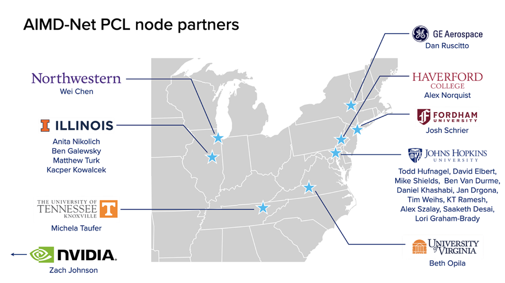

---
# ---- Confirmed in layouts/single.html ----
title: AIMD-Net PCL
date: 2026-11-14
summary: A Programmable Cloud Laboratory at Johns Hopkins

show_breadcrumb: true
show_date: true          # set false to hide the date
reading_time: false      # hide the "N min read" label

authors:
  - me
  - harrison-park
  - gannon-murray
  - alex-dejong
  - ethan-bernstein

#links:
#  - type: site
#    url: https://hemi.jhu.edu/

# Setting an abstract turns on the details grid for a project page.
#abstract: AIMD-Net is a node in the National Science Foundation's test bed network of Programmable Cloud Laboratories (PCL).

funding:
  - funder: National Science Foundation
    grant: Award No. 2607526
    url: https://www.nsf.gov/

#license: CC BY 4.0

share: false             # hide share buttons in the footer

# ---- Not confirmed for this Hugo Blox version: uncomment one at a time to test ----
# toc: true              # table of contents

# image:                 # featured-image settings (traditional Hugo Blox keys)
#   placement: 2         # 1 = ~720 px (default), 2 = ~1200 px, 3 = full width
#   caption: HELIX target chamber
#   preview_only: false  # true = show on cards only, not on this page

# cover:                 # banner at top of page
#   icon:
#     emoji: "💥"
#     position: inline   # or overlap

# awards:                # structure not confirmed
#   - name: Best Paper Award
---

Automated, high-throughput laboratories such as [AIMD-L]() are transforming materials science and engineering by making it possible to collect, process, and analyze experimental data at tremendous rates. AI and ML models trained on these data can drive materials exploration campaigns and can themselves make decisions about what experiments to do next --- true autonomous research.

But any single laboratory has a limited set of capabilities. Expensive or specialized instruments will only exist in a few places, and some types of equipment are incompatible (we wouldn't usually want to put precision laser optics and rolling mills in the same lab, for example). So any complex research program is almost always going to need to access more than one laboratory.

The next logical step is to realize that although we might need multiple laboratories for a project, these laboratories don't necessarily need be located near each other. Proximity is certainly useful for moving samples around, but data moves easily and researchers can communicate anywhere around the world. A researcher in one location could, at least in theory, conduct their research remotely, using any number of geographically-distributed laboratories.

The NSF Programmable Cloud Laboratory (PCL) Test Bed Network is enabling this vision by establishing the common data, metadata, and AI standards essential to allowing complex autonomous workflows to be conducted across a distributed network of labs. 

[Professor Hufnagel]() is the director of AIMD-Net, a node in the PCL Test Bed Network. The objectives of AIMD-Net fall into three broad areas:
- **Data and information** -- Develop and deploy a robust and flexible data and information infrastructure to enable cooperative, distributed autonomous experimentation across a network of PCLs
- **AI/ML for autonomy** -- Use the data infrastructure to enable integrated AI and ML to advance autonomous experimentation across multiple scales, from individual instruments to individual PCL nodes and finally to the entire PCL network; and
- **Science drivers** --  Deploy data and AI-driven research in AIMD-Net through large-scale autonomous experimental campaigns for (i) multi-objective, data-driven design of structural alloys, and (ii) building a data-driven foundation model for lightweight structural alloys.

The physical home base of AIMD-Net is [AIMD-L](), but its heart is a team of researchers extending well beyond JHU:


